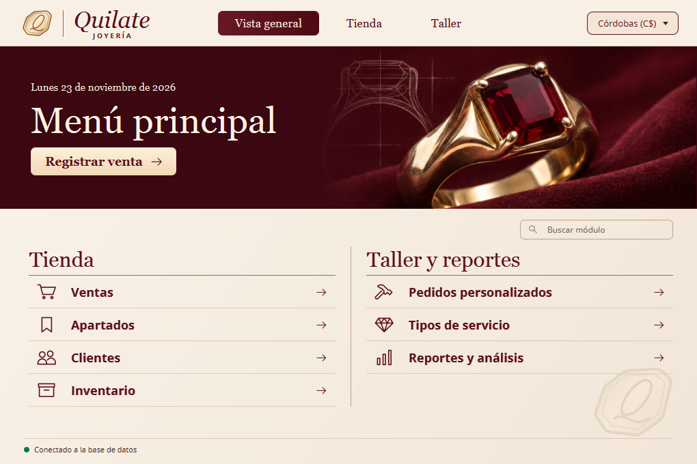
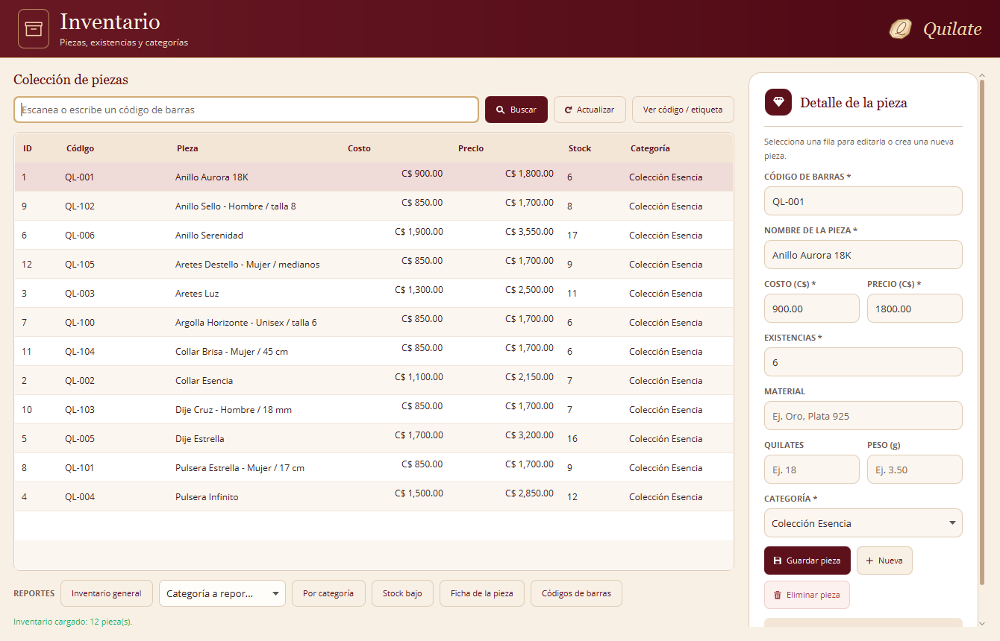
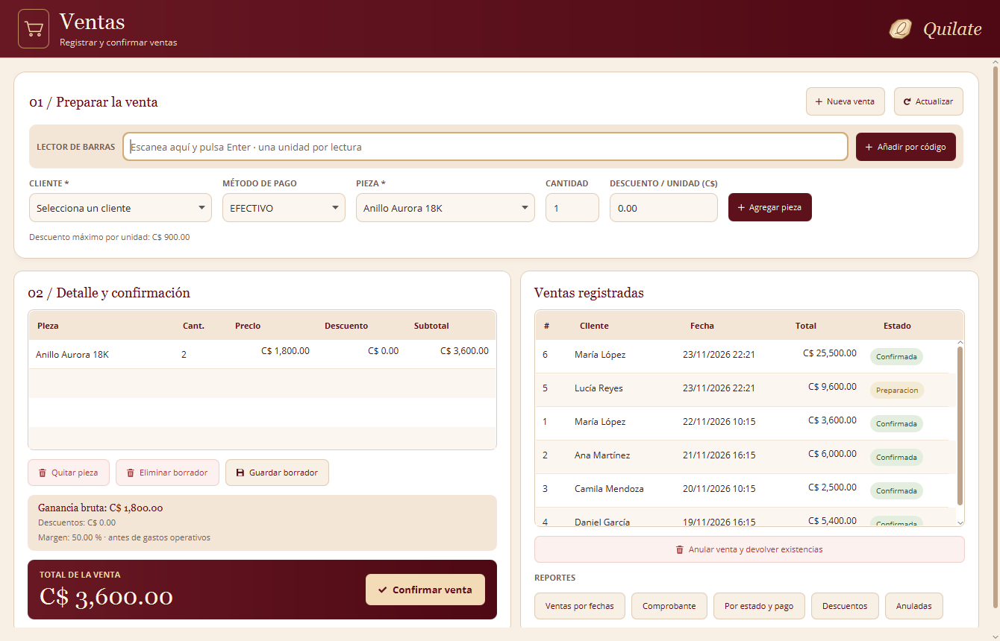
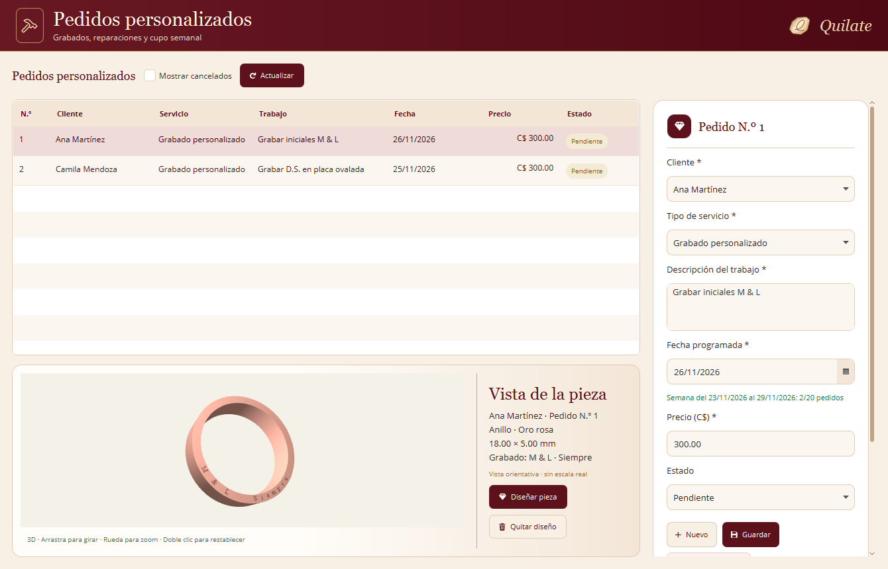
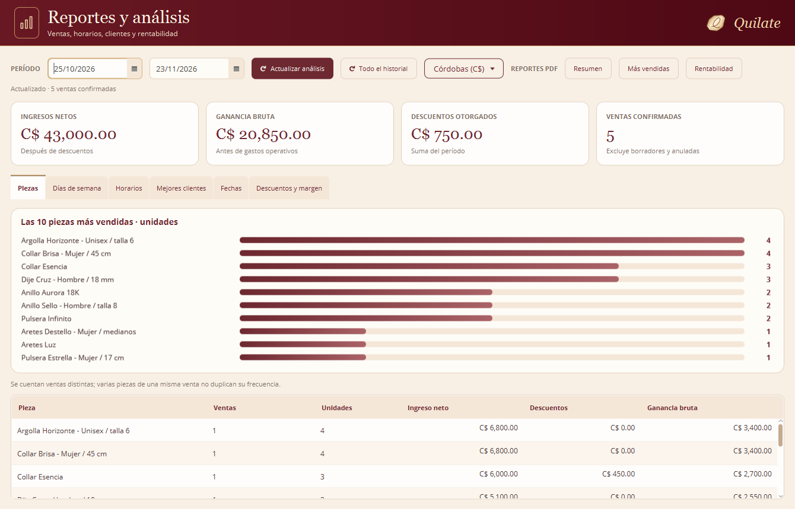
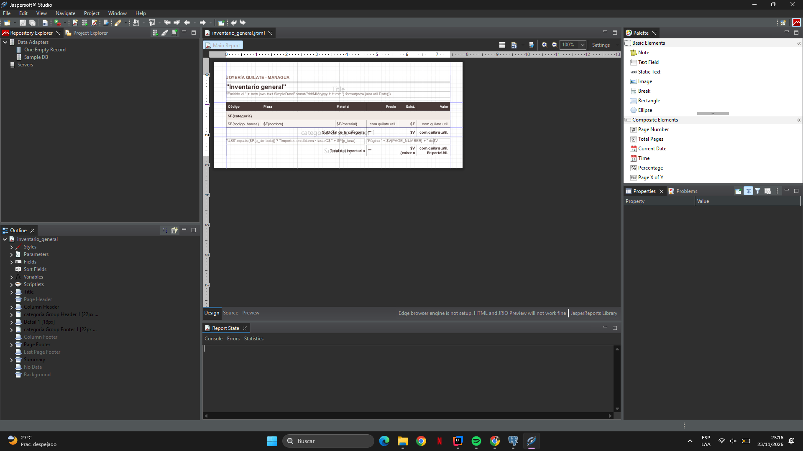
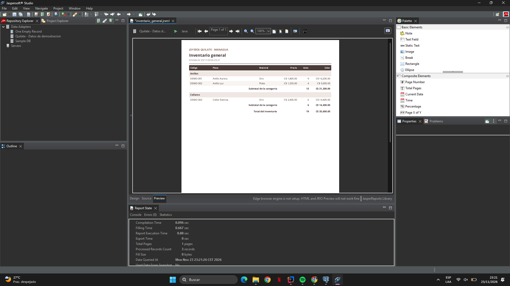
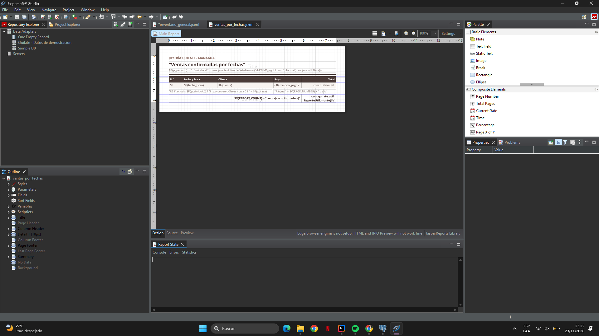
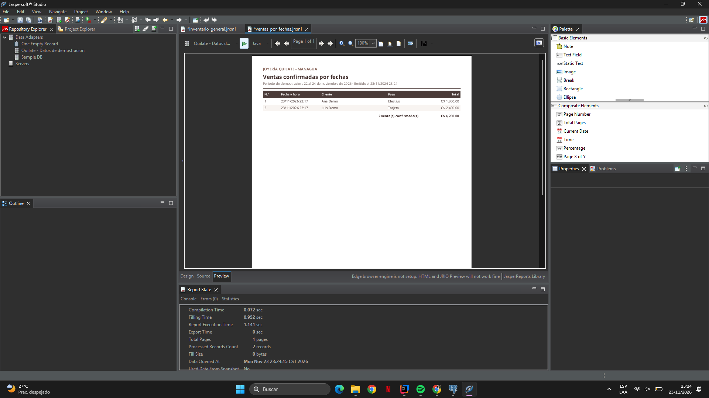

# Quilate — Sistema de Ventas y Análisis de Clientes para Joyería

Aplicación de escritorio en **JavaFX** con persistencia mediante **Hibernate ORM (JPA)** y **PostgreSQL**.
Registra piezas por código de barras, ventas, descuentos con límite de rentabilidad,
pedidos personalizados (grabados, reparaciones…) con cupo semanal y reportes de ventas.

## 1. Proyecto y requisitos

| Herramienta | Versión |
|---|---|
| Java (JDK) | 21 |
| IntelliJ IDEA | Community o Ultimate (2024.1 o superior) |
| PostgreSQL | 15 o superior (con pgAdmin o `psql`) |
| Maven | No hace falta instalarlo: el proyecto incluye `mvnw` |

Dependencias principales (se descargan solas desde `pom.xml`): JavaFX 21.0.5, Hibernate ORM 6.6.4,
driver PostgreSQL 42.7.4. Para las pruebas: JUnit 5 y H2.

### Estructura del proyecto

```
src/main/java/com/quilate/
├── Launcher.java        ← punto de entrada (ejecutar este)
├── MainApp.java         ← aplicación JavaFX
├── model/               ← entidades @Entity (Cliente, Pieza, Venta, DetalleVenta, TipoServicio, PedidoPersonalizado…)
├── dao/                 ← GenericDAO (CRUD) + un DAO por entidad y ReporteDAO (consultas HQL)
├── dto/                 ← resultados de consultas (PiezaMasVendida)
├── service/             ← reglas de negocio y validaciones (cupo semanal, etc.)
├── controller/          ← controladores de las vistas FXML
├── exception/           ← ReglaNegocioException
└── util/                ← JPAUtil (EntityManagerFactory), Transaccion, Tareas, AlertUtil, Formatos
src/main/resources/
├── hibernate.cfg.xml
├── fxml/                ← vistas (main, ventas, pedidos, servicios, reporte_piezas)
└── css/styles.css
src/test/java/           ← pruebas automáticas con H2 en memoria
database/
├── 01_quilate_bd_inicial.sql       ← inventario, clientes, apartados, ventas y categorías base
├── 02_pedidos_y_estado_venta.sql   ← tipo_servicio y pedido_personalizado
├── 03_diseno_personalizado.sql     ← columnas del diseño de cada pedido
└── 04_reemplazar_datos_demo.sql    ← datos ficticios (borra y reemplaza los existentes)
```

## 2. Instalación y ejecución

1. Abrir pgAdmin (o `psql`) con el usuario administrador y crear la base:
   ```sql
   CREATE DATABASE quilate;
   ```
2. Conectarse a la base `quilate` y ejecutar **en este orden** los scripts de la carpeta `database/`:
   1. `01_quilate_bd_inicial.sql`
   2. `02_pedidos_y_estado_venta.sql`
   3. `03_diseno_personalizado.sql`
   4. `04_reemplazar_datos_demo.sql` (opcional: carga datos ficticios para practicar)

   En pgAdmin: clic derecho sobre `quilate` → **Query Tool** → abrir el archivo → **Execute (F5)**.
   Con `psql`:
   ```bash
   psql -U postgres -d quilate -f database/01_quilate_bd_inicial.sql
   ```
   ```bash
   psql -U postgres -d quilate -f database/02_pedidos_y_estado_venta.sql
   ```
3. (Recomendado) Crear un usuario solo para la aplicación en lugar de usar `postgres`:
   ```sql
   CREATE USER quilate_app WITH PASSWORD 'elige_una_contraseña';
   GRANT CONNECT ON DATABASE quilate TO quilate_app;
   GRANT USAGE ON SCHEMA public TO quilate_app;
   GRANT SELECT, INSERT, UPDATE, DELETE ON ALL TABLES IN SCHEMA public TO quilate_app;
   GRANT USAGE, SELECT ON ALL SEQUENCES IN SCHEMA public TO quilate_app;
   ```

Los cambios al esquema se agregan como un archivo nuevo (`03_...sql`) con `ALTER TABLE`;
no se editan los scripts que ya se ejecutaron.

### Configurar la conexión con variables de entorno

La aplicación **no tiene credenciales en el código**. `JPAUtil` las lee de estas variables de entorno:

| Variable | Ejemplo |
|---|---|
| `DB_URL` | `jdbc:postgresql://localhost:5432/quilate` |
| `DB_USER` | `quilate_app` |
| `DB_PASSWORD` | *(tu contraseña local)* |

### En IntelliJ IDEA

1. Abrir `Launcher.java` y pulsar el ▶ verde junto a `main` una vez (crea la configuración "Launcher").
2. Menú **Run → Edit Configurations… → Launcher**.
3. En **Environment variables** pegar (con tus datos):
   ```
   DB_URL=jdbc:postgresql://localhost:5432/quilate;DB_USER=quilate_app;DB_PASSWORD=tu_contraseña
   ```
4. **OK**. Deja desmarcada la opción *Store as project file* para que la configuración (con la contraseña)
   no se suba al repositorio.

### En Windows (terminal)

```powershell
setx DB_URL "jdbc:postgresql://localhost:5432/quilate"
setx DB_USER "quilate_app"
setx DB_PASSWORD "tu_contraseña"
```

Cerrar y abrir de nuevo la terminal o IntelliJ para que tome los valores.

### Alternativa: archivo `db.properties`

También se puede copiar `db.properties.example` como `db.properties` en la raíz del proyecto y poner ahí los datos.
Ese archivo está en `.gitignore`. Si existen ambos, las variables de entorno tienen prioridad.

Por defecto `hibernate.hbm2ddl.auto=validate`: Hibernate comprueba al arrancar que las entidades coincidan con
las tablas y **no modifica la base**. Si falta una tabla o columna, la aplicación lo indica en la barra inferior.

### Generar tablas con Hibernate en una base de prueba

Para demostrar la generación automática, crea una base PostgreSQL vacía y
configura una conexión cuyo usuario pueda crear tablas. Define
`DB_SCHEMA_MODE=update` y ejecuta la aplicación. Hibernate usará los ocho
mapeos de `hibernate.cfg.xml` para generar el esquema. Para una instalación de
uso normal, aplica los scripts SQL, que incluyen restricciones y datos iniciales,
y deja el modo predeterminado `validate`.

### Ejecutar

**Desde IntelliJ IDEA:**

1. **File → Open** → seleccionar la carpeta del proyecto. IntelliJ lo importa como proyecto Maven
   (si pregunta, elegir **Trust Project** y el JDK 21).
2. Esperar a que termine de descargar las dependencias (barra inferior).
3. Abrir `src/main/java/com/quilate/Launcher.java` → **Run 'Launcher.main()'**.

**Desde la terminal** (con las variables de entorno definidas):

```bash
./mvnw javafx:run
```

En Windows: `mvnw.cmd javafx:run`.

La barra inferior de la ventana indica si la conexión con PostgreSQL fue exitosa.

### Pruebas automáticas

Las pruebas usan H2, incluida una base temporal en disco para comprobar la recuperación de datos después de cerrar y volver a abrir Hibernate:

```bash
./mvnw test
```

En IntelliJ: clic derecho sobre `src/test/java` → **Run 'All Tests'**.

## 3. Funcionalidades

### Inventario, clientes y apartados

- **Inventario**: alta, consulta, edición y eliminación de piezas, búsqueda por lector de código
  de barras y administración de categorías (crear, editar y eliminar). Las piezas usadas en
  ventas o apartados y las categorías con piezas no se pueden eliminar.
- **Clientes**: registro, edición, eliminación de clientes sin movimientos e historial de
  compras confirmadas. El total neto considera la cantidad y el descuento de cada venta.
- **Apartados**: reservar piezas, ajustar cantidades, cancelar devolviendo existencias y
  convertir la reserva en una venta sin descontar el inventario nuevamente.
- Cada pantalla incluye una acción **Actualizar** para consultar cambios de otros módulos.

### Integrante 3: ventas y descuentos

- **Ventas** (ventana *Ventas*): permite seleccionar cliente y método de pago, agregar piezas,
  cambiar cantidades, aplicar descuentos monetarios por unidad y guardar ventas en preparación.
- El descuento máximo se calcula como `precio de venta - costo`; no se permite vender bajo costo.
- Al confirmar, la venta, sus detalles y la reducción de existencias se guardan en una sola
  transacción. Si falta stock o falla alguna operación, Hibernate revierte todo.
- Las ventas confirmadas no se borran: se anulan y el inventario se reintegra una sola vez.
- `VentaService.confirmarDesdeApartado` convierte un apartado activo sin descontar dos veces,
  verifica pieza y cantidad, y marca el apartado como completado en la misma transacción.

### Integrante 4: pedidos personalizados y reportes

- **Tipos de servicio** (ventana *Tipos de servicio*): CRUD completo. No se permiten nombres repetidos
  ni precios negativos, y no se puede eliminar un servicio que ya se usó en pedidos.
- **Pedidos personalizados** (ventana *Pedidos personalizados*): registrar, consultar, modificar y cancelar
  grabados, reparaciones y otros trabajos.
  - Relaciones: un **cliente** tiene muchos pedidos y un **tipo de servicio** se usa en muchos pedidos (`@ManyToOne` / `@OneToMany`).
  - **Límite: 20 pedidos activos por semana (lunes a domingo).** Si la semana está llena, el pedido se rechaza
    y se avisa. El cupo se vuelve a revisar cuando se **cambia la fecha** de un pedido.
    Al elegir una fecha se muestra cuántos pedidos hay en esa semana.
  - Cancelar no borra el pedido: lo marca como `CANCELADO` y libera su espacio.
- **Consulta HQL — piezas más vendidas** (ventana *Piezas más vendidas*): une `DetalleVenta`, `Venta` y `Pieza`
  y suma las cantidades vendidas **solo de ventas confirmadas**; se muestra en un gráfico de barras y una tabla.
  Está en `ReporteDAO.piezasMasVendidas`.

## 4. Modelo de datos

| Entidad | Relaciones y función |
|---|---|
| Categoría | Clasifica muchas piezas. |
| Pieza | Pertenece a una categoría y aparece en detalles de venta y apartados. El código de barras es único. |
| Cliente | Se asocia a ventas, apartados y pedidos personalizados. |
| Apartado | Reserva una pieza para un cliente. Puede convertirse en una sola venta. |
| Venta | Pertenece a un cliente, contiene detalles y puede tener un apartado de origen único. |
| DetalleVenta | Une una venta con una pieza y guarda cantidad, precio, costo y descuento aplicados. |
| TipoServicio | Clasifica los pedidos del taller. |
| PedidoPersonalizado | Pertenece a un cliente y a un tipo de servicio. Guarda los parámetros opcionales del grabado. |

## 5. Decisiones de diseño y persistencia

- **Relación 1–N.** El detalle guarda la clave de venta con `@JoinColumn`. La venta declara `mappedBy` y sincroniza ambos lados con `agregarDetalle` y `limpiarDetalles`. Los detalles dependen de la venta, por eso se aplica cascada y eliminación de huérfanos.
- **Relación 1–1.** Una restricción única sobre `apartado_origen_id` impide reutilizar el mismo apartado en dos ventas. La conversión usa el inventario ya reservado.
- **Transacciones.** La aplicación comparte una `SessionFactory`. Cada operación abre su sesión o gestor de entidades, confirma los cambios juntos o revierte ante un error y cierra los recursos.
- **Consultas.** La búsqueda por código enlaza un parámetro nombrado, los pedidos cargan cliente y servicio con `JOIN FETCH` y las piezas más vendidas usan `SUM` y `GROUP BY`. Los valores de entrada se enlazan como parámetros.
- **Grabados.** Guardamos forma, texto y medidas junto a cada pedido. Con esos datos el visor reconstruye la pieza al abrirla.

## 6. Control de versiones

1. `main` siempre debe compilar. No se hace push directo a `main`.
2. Cada integrante trabaja en su propia rama creada desde `dev`:
   ```bash
   git checkout dev
   ```
   ```bash
   git pull
   ```
   ```bash
   git checkout -b Feature/TuNombre
   ```
3. Commits pequeños y descriptivos: `feat: agregar entidad Pieza y su DAO`, `fix: validar stock negativo`.
4. Subir la rama y abrir un **Pull Request** hacia `dev`. Otro integrante lo revisa y aprueba antes de fusionar.
5. Después de cada merge: `git pull` en `dev` y comprobar que compila (`./mvnw test`) y arranca.
6. Al final, `dev` se integra a `main` con un Pull Request revisado.

### Seguridad

- Nunca subir contraseñas: usar variables de entorno o `db.properties` (ignorado por Git).
- No subir respaldos de la base (`*.backup`, `*.dump`) ni configuraciones locales de IntelliJ.


## 7. Evidencias

Las capturas se generaron con datos ficticios de la prueba visual.

1. **Inicio y estado de conexión.**
   
2. **CRUD de inventario.**
   
3. **Venta y sus detalles.**
   
4. **Pedidos asociados a clientes y servicios.**
   
5. **Reporte de piezas más vendidas.**
   

### Reportes en Jaspersoft Studio 6.21.3

Las vistas **Preview** se ejecutaron con datos ficticios de una base local.

**Inventario general**

- **Design**
  
- **Preview**
  

**Ventas por fechas**

- **Design**
  
- **Preview**
  

## Entrega y defensa

**Integrantes:** Kate Ramirez, Erick Arana, Reynolds Rodriguez y Francisco Cuadra.

- [Guion para los cuatro integrantes](docs/entrega/DEFENSA.md).
- [Reportes compilados y PDF de muestra](docs/entrega/reportes/).
- [Configuración y scripts para MySQL](database/mysql/README.md).
